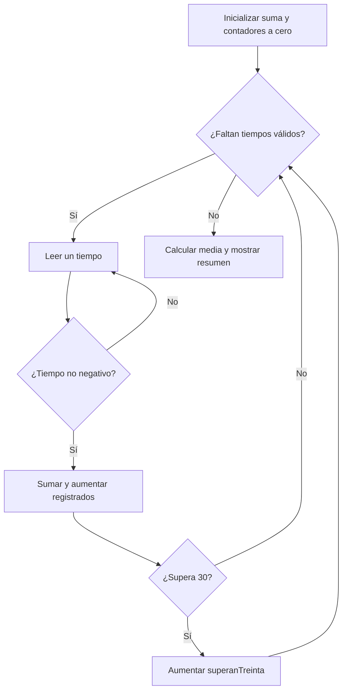

# Del enunciado al algoritmo

> Apunte didáctico propio, preparado para el alcance básico indicado. No se atribuye a una corrección del profesor.

## Primero entender, después escribir Java

Un algoritmo es una secuencia de pasos que resuelve un problema para las entradas admitidas. No empieza eligiendo un `for`: empieza fijando qué se recibe y qué debe obtenerse. «Calcular una media» está incompleto si no sabemos cuántos datos hay, qué valores se aceptan o qué ocurre cuando no hay ninguno.

**Ejemplo didáctico propio:** registrar tres tiempos de reparto no negativos y mostrar su media y cuántos superan 30 minutos. Los valores negativos son inválidos y deben volver a pedirse, sin consumir una de las tres lecturas válidas.

| Parte | Decisión |
| --- | --- |
| Entradas | Tres números enteros válidos, en minutos |
| Proceso | Validar cada lectura, sumar y contar los mayores de 30 |
| Salidas | Media decimal y recuento |
| Variables que conservan información | `suma`, `superanTreinta`, `registrados` |
| Dato de la vuelta | `tiempo` |
| Casos de prueba | 10, 30, 50 → media 30 y un valor mayor de 30 |

## Diseñar el flujo



El rombo representa una decisión; el rectángulo, una acción. La flecha de retorno explica la repetición. Cada paso debe poder traducirse a una condición o instrucción concreta; «hacer la media» no explica todavía cómo conservar la suma.

## Traducción razonada a Java

```java
java.util.Scanner entrada = new java.util.Scanner(System.in);
int registrados = 0;
int superanTreinta = 0;
double suma = 0;
while (registrados < 3) {
    int tiempo = entrada.nextInt();
    if (tiempo >= 0) {
        suma += tiempo;
        registrados++;
        if (tiempo > 30) {
            superanTreinta++;
        }
    } else {
        System.out.println("Tiempo no válido");
    }
}
double media = suma / registrados;
System.out.println(media + " " + superanTreinta);
```

Las inicializaciones van antes: representan el estado «ningún tiempo registrado». La lectura va dentro porque cambia el dato. La suma y los contadores van dentro del `if` válido para que -1 no altere el resultado. El contador de tiempos y el de tiempos lentos son distintos: no todos los válidos superan 30. La media va después para utilizar el total definitivo. El ejemplo supone tokens enteros; no incluye validación de formato.

## Practica

Adapta el análisis a cuatro consumos de agua positivos y cuenta los que no superan 12 litros. Entrega entradas/proceso/salidas, diagrama, lista de variables y un caso resuelto a mano antes del código. Relación: [trazas y validación](trazas-y-validacion.md).

---

[Índice del tema](README.md) · [Ejercicios para practicar](ejercicios.md) · [Índice general](../../README.md)
